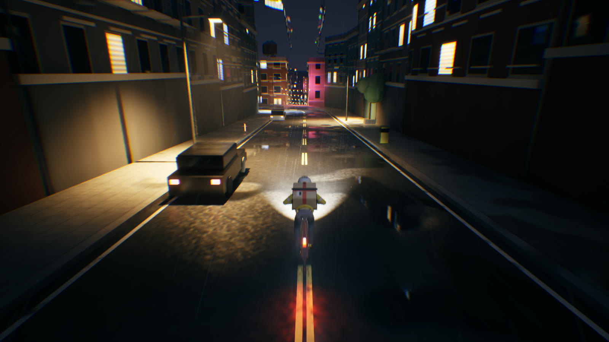

# Midnight Courier

One package. Ridiculously fragile. Two minutes to get it down the hill.

A downhill bike game: deliver a box of antique glass across a rainy hillside city. Bomb down staircases, thread
the alley and jump the canal to beat the clock, but every hard landing rattles the package, and the tip at the
door pays for speed *and* care. Instant restart, ghost of your best run, keyboard or gamepad.

- **Play in your browser:** https://nearbycoder.github.io/midnight-courier/play/
- **Site and trailer:** https://nearbycoder.github.io/midnight-courier/
- **Mac app (Apple silicon):** [latest release](https://github.com/nearbycoder/midnight-courier/releases/latest)

| Folder | What's in it |
|---|---|
| [`MidnightCourier/`](MidnightCourier/README.md) | The Unreal Engine 5 game: C++ source, the Blender scripts that generate the bike, rider and the whole city, procedural materials, synthesized audio, build and packaging scripts |
| [`web/`](web/) | The marketing site (GitHub Pages) |
| [`web/play/`](web/play/README.md) | The browser version (three.js), built from the same generated assets |

